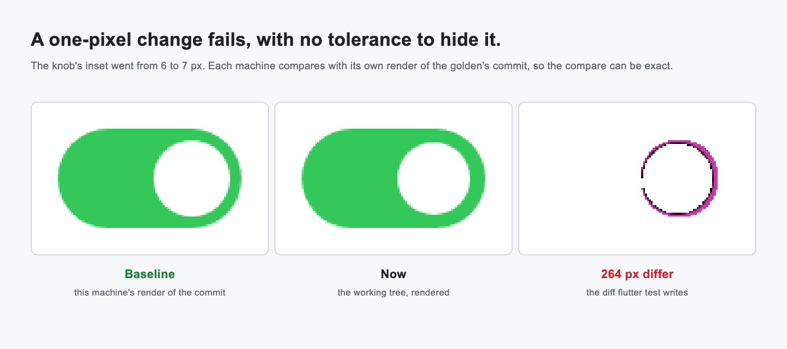

# portable_goldens

Exact golden tests that pass on every machine. Each machine compares a golden against **its own
render** of the commit that last changed it, so two machines that draw the same widget a few
pixels apart can run the same committed goldens with no tolerance.



```text
  committed png  ──  what the reviewer sees; written by --update-goldens, as always
       │
       │  git log -1 -- <png>   →  commit C
       ▼
  render of C on THIS machine   ◄── exact compare ──►   render of HEAD on THIS machine
  (built once in a throwaway worktree, cached per machine)
```

## The problem

Goldens are only as portable as the renderer. Two Macs with the same Flutter, engine, Dart and
`flutter_tester` binary rendered the same widgets 1 to 20 pixels apart, at the anti-aliased
edges of circles. The only difference between them was the OS: macOS 26.6.2 (25G83) and macOS
27.2.1 (26B131). The goldens committed from one failed on the other, all 19 of them.

The usual answers each give something up:

| Approach | Examples on pub | What it costs |
|---|---|---|
| A pixel or perceptual **tolerance** | `golden_delicious`, `gleon`, alchemist's tolerance | A real 1-pixel regression passes too. |
| **Per-platform folders**, Ahem-font CI goldens | `alchemist` | One set of pngs per platform to keep up to date; CI goldens show boxes, not text; two Macs on different OS versions are still "one platform". |
| One **pinned environment** for every render | `golden_runner` (Docker) | Every golden run goes through a container, which still sometimes disagrees with CI. |
| **Compare only on one machine** | many suites in practice | Everyone else skips, or regenerates and commits noise. |

portable_goldens keeps the compare exact and the committed pngs unchanged, and moves the question
from "does this machine draw what that machine drew?" to "does this code draw what the code that
made the png drew, **here**?".

What follows from that:

- **No tolerance.** `GoldenFileComparator.compareLists`: every pixel equal, or it fails.
- **One set of pngs.** Nothing per platform, nothing per developer, nothing extra committed.
- **An OS, engine or Flutter upgrade does not churn the goldens.** The new environment gets its
  own baselines, rendered from the same commits, so only a change in *your* code fails a test.
  That holds while those commits still build and pass on the new SDK; one that does not fails
  its goldens loudly, naming the build (see [Limits](#limits)).
- **A dependency upgrade that moves pixels is caught**, when the package commits its
  `pubspec.lock`: the baseline renders with the old commit's lock, the test with the new one.
- **Every worktree and clone on a machine shares one cache**, so a commit is rendered once per
  machine.

## Requirements

- Flutter 3.47 or later (Dart 3.13).
- `git` on the `PATH`, and the package inside a git repository with **full history**. A shallow
  clone, no git, or a package outside a repository falls back to the committed images (see
  [Fallbacks](#fallbacks)). Goldens in Git LFS need `git lfs`, and git 2.42 or later to read
  each commit's png through that commit's own `.gitattributes`; an older git uses the working
  tree's.
- macOS, Linux or Windows. On Windows a setup step is batch syntax (see
  [Generated code: setup steps](#generated-code-setup-steps)).
- Tests that use `matchesGoldenFile` with Flutter's own `LocalFileComparator`. A package that
  swaps in its own comparator during each test, as alchemist's `goldenTest` does, takes the
  compare back from portable_goldens.

## Setup

```yaml
dev_dependencies:
  portable_goldens: ^0.1.0
```

```dart
// test/flutter_test_config.dart
import 'dart:async';

import 'package:portable_goldens/portable_goldens.dart';

Future<void> testExecutable(FutureOr<void> Function() testMain) async {
  PortableGoldenComparator.install();
  await testMain();
}
```

`flutter test` finds `flutter_test_config.dart` by walking up from each test file, so one file at
`test/` covers every test. Nothing else changes: tests still call `matchesGoldenFile`, and
`--update-goldens` still writes the committed pngs.

`install()` replaces only the plain `LocalFileComparator` that `flutter test` sets. If something
else is in place when it runs, such as another package's comparator or your own subclass of
`LocalFileComparator`, it leaves that comparator alone and prints once, on stderr, that goldens
compare with it and not with machine baselines. Pass `strict: true` to make that an error
instead, so a suite cannot run with goldens that are not machine-checked:

```dart
PortableGoldenComparator.install(strict: true); // throws a StateError if it cannot install
```

Calling `install()` again is a no-op.

### Generated code: setup steps

A baseline is built in a checkout of the commit, which has only what git tracks. Code that
`build_runner`, a localization tool or a script generates, and that git ignores, is not there, so
the build fails to compile. Name the commands that generate it in your `pubspec.yaml`:

```yaml
portable_goldens:
  setup:
    - dart run build_runner build --delete-conflicting-outputs
    - flutter gen-l10n
```

Each command runs in the checkout's package folder after `flutter pub get` and before the tests,
in order, through `/bin/sh -c`, so quoting, `&&` and variables work as in a terminal. On Windows
each command is the one line of a batch file run by `cmd.exe /d /c`, so it is batch syntax there:
write a literal `%` as `%%`. The test's Flutter SDK is first on its `PATH`, so `dart` and `flutter` are
that SDK's. A command that exits non-zero fails the build, with its output and the whole build's
command, and no test runs.

The steps are read from the package's `pubspec.yaml` as it is on disk now, not as it was at each
commit, so a step added today also builds older commits. They are part of the baseline's name in
the cache ([Where baselines live](#where-baselines-live)): changing them builds new baselines and
never reuses ones built with other steps. A misspelled key, a step that is not a string, or YAML
that does not parse fails every golden, and `prepare`, `report` and `verify`, naming the file and
the problem, rather than building without the step. `prune` does not read the steps.

## Day to day

```sh
dart run portable_goldens:prepare   # optional: build every missing baseline now
flutter test                       # compare
dart run portable_goldens:report    # what failed, and what this branch changed
dart run portable_goldens:verify    # before pushing: can each commit draw its own png?
dart run portable_goldens:prune     # now and then: remove the baselines nobody needs
```

**Changing a widget on purpose.** Run `flutter test --update-goldens`, look at the new pngs,
commit them. Until they are committed they compare against themselves in the working tree; once
committed, their new commit is the baseline. `report` lists each one as *changed by this branch*
with a diff against what it was before the branch, which is what a reviewer wants to see.

**A golden fails.** The message says what it was compared with (this machine's render of commit
`C`, the working-tree png, or the committed image and why) and where Flutter wrote the diff
images, in `failures/` beside the test as usual. `report` lists every failure from the last run.

**A baseline build fails.** The golden fails loudly with the commit, the command (ready to paste
into a shell) and the end of its output. The usual cause is an old commit that no longer builds
with today's SDK. Re-render the png on your branch and commit it: its baseline moves to a commit
that builds.

**Before pushing.** `verify` checks that each png the branch committed is what its commit draws
on this machine. A png committed before its last code change, or with only part of the code
(`git add -p`, a rebase that split a commit), is a picture no commit can draw, and nothing else
notices: every machine compares the golden with its commit's render, not with the png. Run it on
the machine that rendered the pngs, since anywhere else every png differs by the machine too.

**After an OS or Flutter update.** The first run rebuilds the baselines it needs, one test run per
commit. Run `prepare` once to pay that up front. The old key's baselines stay until `prune`
removes them.

### `prepare`

Builds the baselines that are missing, one commit at a time, and prints the machine key and where
the baselines live. It is optional, because a test builds what it needs, but it keeps the build
time out of the test run and shows a failed build on its own rather than inside a test. It exits
1 if a build failed, or if a build passed without writing a golden it should have: it asks the
store again before it says every baseline is in place.

### `report`

Reads what the last test run recorded and lists two groups:

1. Each golden that **failed**, against this machine's baseline or against the committed image or
   working-tree png it fell back to, with the paths of its diff images.
2. Each golden **changed by this branch**, with its diff against what it was before the branch, or
   "no diff". A golden the run did not compare says "not compared yet".

It exits 1 if anything failed. With `--json` it writes the same two groups as one JSON document,
for tools. Every `--json` document starts with its `schema` and `version`. The version goes up
when a field is removed or changes meaning, never for a new field, so a tool can refuse a version
it does not know:

```json
{
  "schema": "portable_goldens.report",
  "version": 1,
  "base": "<the commit the branch is measured from>",
  "failed": [{"golden": "test/goldens/b.png", "diffs": ["<path of a diff image>"]}],
  "changed": [
    {"golden": "test/goldens/a.png", "compared": true, "baseline": "<what it was compared with>", "diffs": ["..."]},
    {"golden": "test/goldens/c.png", "compared": false, "diffs": []}
  ]
}
```

### `verify`

For each golden the branch changed (every tracked golden with `--all`), renders the commit that
last changed it, building the baseline if it is missing, and compares that render with the png
the commit holds, pixel for pixel, with the compare `matchesGoldenFile` uses. A png changed in the
working tree is checked as HEAD has it. Each golden is one of:

- **verified**: the png is exactly what its commit draws here;
- **MISMATCH**: it is not. The committed png, the render and the diff images are kept in
  `.dart_tool/portable_goldens/verify/mismatches/<golden>/`, and the message names the commit;
- **UNBUILT**: the commit's baselines failed to build, so there is nothing to check against;
- **NOT CHECKED**: it could not be checked, and says why (the pixel compare failed to run, or
  the committed png is a Git LFS pointer, say);
- **uncommitted**: a new png with no commit yet, which is not a failure.

It exits 1 on anything but verified or uncommitted: a check that did not run is not a pass. It
also exits 1, without checking, where machine baselines do not apply (a shallow clone, no git).
The pixel compare needs a Flutter test binding, so it runs as one generated `flutter test` in
`.dart_tool/portable_goldens/verify/`, for every png whose bytes differ from its render. With
`--json` it writes `{"schema": "portable_goldens.verify", "version": 1, "machine", "passed",
"checks": [{"golden", "result", ...}]}`, for tools.

As a git pre-push hook, in `.git/hooks/pre-push`:

```sh
#!/bin/sh
cd path/to/package && dart run portable_goldens:verify
```

### `prune`

Removes from the cache the baselines nobody needs, and says what it removed and why:

- baselines **unused for 30 days** (`--older-than <days>`), whatever the commit, in any repository
  and under any machine key. A key from before an OS or SDK update is never used again, so its
  baselines go by this rule; one that another project on another Flutter SDK still uses stays;
- baselines of a commit **no branch, tag or checkout here has** (rebased, amended or squashed
  away, or its branch deleted), once unused for a day. The day keeps what a test may be reading
  now, and what another clone of the repository, with other branches, used today;
- a machine key's folder once nothing is left in it and nothing opened it for as long.

A baseline is used when a test reads it, and a key folder when a test process opens it. The cache
is shared by every repository on the machine, so a commit the repository you run it in does not
have may be another's, and only age removes it; outside a repository, only age removes anything.
Baselines a build is writing are kept and listed as in use, and anything in the cache folder that
the package did not write is left alone. `--dry-run` says what would go and removes nothing. It
exits 1 when something could not be removed. Removing a baseline that was needed after all costs
one rebuild, never a wrong result.

### Options every command takes

`prepare`, `report` and `verify` take `--goldens <pathspec>` (or `--goldens=<pathspec>`), a git
pathspec relative to the package. The default is `**/goldens/**/*.png`. Run them from the
package's root. Every command takes `--help`, which prints its usage. An option a command does
not take exits 64, with the usage, as does a value it cannot use (`--older-than 0`, say). Inside a
baseline build every command refuses and exits 1, since it would build from within a build.

## Working with git

A baseline is named by a commit's sha, so what git does to commits is what the package sees.

**Harmless: a rebuild at most.**

- **Rebase, amend, squash, cherry-pick.** The commits get new shas, so a golden whose png is in
  one of them gets a baseline built for the new sha the first time a test needs it. The old
  commit's baselines are unreachable now, and `prune` removes them a day later.
- **Merging,** either way. A png the merge did not change keeps its commit, and its baseline.
- **Switching branches, worktrees and clones.** They share one cache on a machine, so a commit is
  built once.
- **Force-pushing.** Other machines see the new shas and build them, as for a rebase.

**Failures that are right.**

- **A merge, rebase or dependency upgrade that changes what a widget draws** fails its golden,
  against the render of the png's commit, until someone re-renders the png, looks at it and
  commits it. That is the regression check working.
- **Uncommitted code that moves pixels** fails the same way: the baseline is the committed png's
  commit, never your working tree.

**What breaks, and what the package does about it.**

- **A png committed ahead of its code, or apart from it.** Re-rendering, then changing the code
  again before committing; `git add -p`; a rebase that splits a commit. No commit draws that png,
  and the tests pass on every machine all the same, because they compare with the commit's
  render. `verify` catches it, on the machine that rendered the png. Run it before pushing.
- **Inputs the commit does not track.** A build's checkout has only what the commit has, so an
  untracked asset or font is missing there: the build fails with its output, or draws without
  it. Commit what the goldens need. Generated code that is ignored is regenerated by
  [setup steps](#generated-code-setup-steps), when the pubspec names them.
- **Path dependencies outside the repository** are given to the build as they are on disk now, not
  as they were at the commit ([Limits](#limits)).
- **Submodules** are checked out at the commit's sha, cloned from their URLs, so a build needs
  those URLs to be reachable.
- **Git LFS** needs `git lfs` installed and the objects fetched. A pointer is never compared as an
  image ([Git LFS](#git-lfs)).
- **A shallow clone** falls back to the committed images ([Fallbacks](#fallbacks)). Fetch full
  history wherever goldens run.

## In CI

CI is one more machine. Give it what a laptop has:

```yaml
# GitHub Actions
- uses: actions/checkout@v4
  with:
    fetch-depth: 0               # full history: a shallow clone falls back to the committed images
- uses: actions/cache@v4
  with:
    path: ~/.cache/portable_goldens  # Linux's; on another OS, the table in "Where baselines live"
    key: portable-goldens-${{ runner.os }}-${{ hashFiles('**/goldens/**/*.png') }}
    restore-keys: portable-goldens-${{ runner.os }}-
- run: dart run portable_goldens:prepare
- run: flutter test
- run: dart run portable_goldens:report
- run: dart run portable_goldens:prune   # keep the saved cache to the baselines still in use
```

Without the cache, every run renders every baseline it needs: one `flutter test` of the golden
files for each distinct commit that last changed a golden. With it, a run renders only the commits
new since the cached one. The cache key may be anything; the machine key inside the cache already
keeps one runner image's renders apart from another's.

With a shallow clone, CI compares with the committed images like a plain `flutter test`, and
says so once per test process.

## How it works

### Which baseline a golden compares with

For each golden, in this order:

1. **The png differs from HEAD**: staged, unstaged or new. No commit has it to render, so it is
   compared exactly with the png in the working tree. That png is normally what
   `--update-goldens` just wrote on this machine, so the compare is still this machine against
   itself, and a render a pixel off it fails.
2. **Otherwise**, its baseline is this machine's render of `git log -1 --format=%H -- <png>`, the
   commit that last changed it. A png committed on this branch is no exception: its baseline is
   this machine's render of the branch's commit. On failure, the diff images go to `failures/`
   beside the test, as with `LocalFileComparator`, and the message names the commit and the
   baseline's path.
3. **The committed image**, as a plain `LocalFileComparator` would compare. See
   [Fallbacks](#fallbacks).

Whatever decided the test, a golden that passed and that this branch changed is recorded as
**changed by this branch**, with its diff against what it was before the branch, so a PR says
what moved. "Changed" means the png differs from the **merge-base** of HEAD with the default
branch, rather than from main's tip, because a main that has moved on would otherwise list other
people's goldens as this branch's. "Before the branch" is this machine's render of the commit
that last changed the png at the merge-base; when that commit does not build here, the diff is
against the png committed there instead, which another machine may have rendered. The diff is
information for the review, never a verdict.

The default branch is the newest merge-base among `origin/HEAD`, `origin/main`, `origin/master`,
`main` and `master`, so a stale `origin/main` beside a fresh local `main` does not stretch the
branch back past main. Set `PORTABLE_GOLDENS_BASE` to a ref to choose another. With none of them,
only uncommitted changes count.

### Fallbacks

A golden compares with the committed image when any of these holds, and the reason is printed
once per test process:

- there is no git, or the package is outside a repository;
- the clone is shallow: its history stops at a boundary commit, `git log -1` names that commit for
  every png older than it, and its render is not what the png showed;
- the repository has no commit yet;
- no Flutter SDK can be found, or its engine or framework revision cannot, because an SDK update
  would then go unnoticed;
- the png is outside the package, or no commit has it;
- the commit cannot be checked out;
- the test runs inside a baseline build. This one is the design, so it is never printed.

In code, `CommittedBaseline.reason` is a sealed `FallbackReason` to switch on.

### The machine key

The key holds everything that changes how this machine renders a golden:

| Value | Source |
|---|---|
| OS | `Platform.operatingSystem` |
| OS version and build | `Platform.operatingSystemVersion`, e.g. `Version 27.2.1 (Build 26B131)` |
| Architecture | `Abi.current()`, e.g. `macos_arm64` |
| Engine revision | `<flutter>/bin/cache/engine.stamp`, else `bin/internal/engine.version` |
| Framework revision | the SDK checkout's `.git/HEAD`, else `bin/cache/flutter.version.json` |
| Dart version | `Platform.version` |

A 16-hex-digit hash of those values (FNV-1a, 64-bit) names this machine's folder, and
`manifest.json` beside it records the readable values. When any value changes, the hash names a
new folder, so baselines rendered before the change are never reused. A folder whose manifest
names another key (a collision, or a hand edit) is emptied.

On the two Macs above, the keys differ in the OS version and build alone. The M4 Pro and M4 Max
CPU models are not in the key: the OS already separated them.

**Engine revision.** `engine.stamp` is written by the tool when it downloads the engine
artifacts, so it names the engine `flutter_tester` actually came from. `engine.version` is the
engine the framework checkout asks for, which a checkout can change before the cache catches up.
`flutter --version --machine` reports the same value, but costs a process launch in every test
file. The SDK is found from `FLUTTER_ROOT`, which `flutter test` sets, or else from the running
executable's path.

**Framework revision.** Text layout, painting and every widget are framework code, so a framework
commit on an unchanged engine, as on Flutter's main channel, can move pixels too. It is read from
`.git/HEAD` and the ref it names, without launching git. Uncommitted edits to the framework are
not seen.

### Where baselines live

The cache is per user and outside every repository, so it is never committed and every worktree
and clone shares it.

| OS | Default |
|---|---|
| macOS | `~/Library/Caches/portable_goldens` |
| Linux | `$XDG_CACHE_HOME/portable_goldens`, or `~/.cache/portable_goldens` |
| Windows | `%LOCALAPPDATA%\portable_goldens` |

Set `PORTABLE_GOLDENS_CACHE` to put it somewhere else. The layout:

```text
<cache>/<key id>/manifest.json            the key's readable values
<cache>/<key id>/<commit>/<unit>/         one commit's renders, for one package
<cache>/<key id>/<commit>/<unit>/.complete
<cache>/<key id>/<commit>/<unit>.lock     held while it is built
<cache>/<key id>/<commit>/<unit>.failed   the last build that failed
<cache>/<key id>/<commit>/.<unit>.tmp-*   a build in progress, and its checkout
```

The unit is the package's folder in its repository (`root` at the top), so two packages of one
monorepo never fill each other's folder. A package with [setup steps](#generated-code-setup-steps)
adds a hash of them (`root@<16 hex digits>`), so baselines built with other steps, or with none,
are never read. `prune` reclaims the space of baselines nobody needs; the modification times of
`manifest.json` and `.complete` are when they were last used, which is what it goes by. Deleting
any of it by hand is safe too, and costs a rebuild.

### Building a baseline

The first golden that needs a commit's baselines builds all of them at once:

1. Run `git worktree prune`, then `git worktree add --detach <checkout> <commit>`, with the
   repository's hooks off. The checkout is `.<unit>.tmp-<pid>-<time>-checkout`, beside the build's
   temporary folder in the cache.
2. Give the checkout what a worktree leaves out:
   - **Path dependencies outside the repository.** A `path: ../design_system` is relative to the
     package, so from the checkout it points at nothing. Each package your own
     `.dart_tool/package_config.json` resolves outside the repository is written into a
     `pubspec_overrides.yaml` in the checkout, by absolute path. It goes beside the resolution:
     the package's folder, or a pub workspace's root. A commit that has its own
     `pubspec_overrides.yaml` there keeps it, and the build's command says so.
   - **Submodules.** When the commit has a `.gitmodules`, run
     `git submodule update --init --recursive` in the checkout. Each submodule is cloned from its
     URL; a failure is a build failure naming that step.
3. Run `flutter pub get`, then each [setup step](#generated-code-setup-steps), then
   `flutter test --update-goldens <files>` in the package, with the same SDK as the test. The
   files are the commit's own test files whose source contains `matchesGoldenFile`, or all of
   `test/` when none does.
4. Keep every png the run wrote, judged by mtime. The images checked out from git are never taken
   for renders. A golden the run did not write is a failure.
5. Remove the worktree.

The child run has `PORTABLE_GOLDENS_CHILD=1` set and `FLUTTER_TEST` unset, so it compares with the
committed image and never builds in turn.

`flutter test` runs test files in parallel processes, and other worktrees may build the same
commit, so the build is safe to race:

- **A lock.** `<unit>.lock` takes an advisory `fcntl` lock, which the OS releases when its process
  dies. The second process waits for it, then finds the folder complete and builds nothing. If the
  first build failed while it waited, it gets that failure instead of running the build again.
- **Build, mark, rename.** The images and the `.complete` marker are written to a temporary
  folder, which is renamed into place in one atomic step. A folder without the marker is treated
  as missing and rebuilt, so a half-written baseline is never read as a good one, even where the
  lock does not hold. So is a folder whose marker does not parse, and an image the marker does not
  list.
- **A sweep.** A build killed before its own cleanup (by SIGKILL, say) leaves its temporary folder
  and checkout behind. The next build of that unit deletes every `.<unit>.tmp-*` under the lock,
  and its `git worktree prune` drops the dead checkout's registration. Killing a test process does
  not kill a `flutter test` it started: that orphan runs on in its checkout until the sweep
  deletes it or it finishes, and nothing reads what it wrote.
- **An atomic manifest.** Every test process opens the store at once, so `manifest.json` is
  written to a temporary file and renamed into place. A manifest that cannot be read is rewritten,
  and the baselines beside it are kept: only a readable manifest of another key empties the
  folder.

### Git LFS

Goldens kept in Git LFS work where `git lfs` is installed, as they do for a checkout: a commit's
png is read through the filters the commit's own `.gitattributes` names
(`git -c attr.tree=<commit> cat-file --filters`), so it is the image, not the pointer `git show`
gives. A worktree is checked out through the same filters.

A pointer is never compared as if it were an image. Where `git lfs` is not installed, or a file's
object is not fetched, the pointer is where the png should be, and:

- the test fails with the pointer named, and how to fetch the object, instead of a pixel diff;
- `verify` reports the golden as not checked;
- a golden the branch changed is reported with nothing to compare it with before the branch.

A file git has and cannot read, because a required filter failed (`git lfs` without the object
and no way to download it, say), is said the same way, with what git said.

CI runs the whole workflow with the pngs in Git LFS on Linux, macOS and Windows: render, commit,
prepare, compare, a changed widget failing, verify, prune. Its objects are in the repository's own
store; a download from an LFS server is not tested.

### `--update-goldens`

`flutter test --update-goldens` writes the committed png, as it always has. It does **not**
refresh the machine baseline, for two reasons:

- The updated png is now uncommitted, so rule 1 already applies: the png just written is its
  baseline, and `report` lists the golden with its diff against what it was before the branch.
- The machine baseline is keyed by the commit that last changed the png. Writing today's render
  under that old commit would make the commit's baseline disagree with what it renders, and every
  other worktree on the machine would then compare against it.

Once the png is committed, its new commit gets a baseline of its own the next time it is needed.

### The report's records

Each test run records its outcomes under `.dart_tool/portable_goldens/report/` in the package,
which is where `report` reads them. The first write of a test process deletes the entries an
earlier run left, so a golden fixed or deleted since is not listed. A run is told apart by the
`flutter test` process all its test files share, its pid and start time, asked of `ps` (of
`Win32_Process` on Windows).

## Environment variables

| Variable | Meaning |
|---|---|
| `PORTABLE_GOLDENS_CACHE` | Where the baselines live. |
| `PORTABLE_GOLDENS_BASE` | The ref a branch's changes are measured from (its merge-base with HEAD). |
| `PORTABLE_GOLDENS_CHILD` | Set to `1` inside a baseline build. Set by the package, not by you. |

## Libraries

- `package:portable_goldens/portable_goldens.dart`: `PortableGoldenComparator`, for
  `flutter_test_config.dart`. Exports everything below too.
- `package:portable_goldens/baselines.dart`: the machinery in plain Dart, without `flutter_test`,
  for tools built on it: `MachineKey`, `BaselineStore`, `BaselineBuilder` with its `SetupSteps`,
  `MachineGoldens` (which baseline a golden uses, what is missing, what the branch changed),
  `GoldenReport`, and `GoldenVerifier` with its `PixelComparer`.

## Limits

- **A baseline build costs a test run.** It runs that commit's golden tests: about 18 seconds for
  12 goldens in one measured repository. That cost is paid once per commit per machine key, and
  again after every OS, engine, framework or Dart update.
- **A commit that no longer builds or passes** with today's SDK cannot produce a baseline, and its
  goldens fail with the command that failed. Re-render the png on the branch and commit it to move
  it to a commit that builds.
- **The key is measured, not proven.** The CPU model is left out because the OS version alone
  separated the two machines that prompted this package. If two machines with the same key ever
  render differently, the key needs another field.
- **Only `verify` checks a committed png against its own commit's code.** The baseline is what the
  commit renders here, never the png it committed, so a png committed stale (re-rendered before a
  last code change, say) passes the tests on every machine. `verify` catches it, but only when run
  on the machine that rendered the png, and only if someone runs it: nothing runs it for you.
  `report` does not flag a render that differs from the committed png: on any machine but the one
  that rendered it, every golden differs from it, so the flag would be noise.
- **The committed pngs drift from every machine but the last to render them.** That is by design
  locally, but it means a run that falls back to the committed images (a shallow CI clone, say)
  can fail where a full clone passes.
- **A dependency change is caught only when the lock is committed.** Without a `pubspec.lock` at
  the commit, its baseline resolves today's dependencies, the same as the test.
- **A dependency outside the repository is today's, not the commit's.** The checkout gets the
  folder your own resolution points at now, so a change there since the commit is drawn into that
  commit's baseline. A dependency inside the repository is the commit's own.
- **Setup steps are today's, not the commit's.** They come from the pubspec on disk, so a commit
  whose generator was different (a renamed script, a `build_runner` it did not depend on yet) may
  fail to build with them. Its goldens then fail with the step and its output.
- **A submodule is cloned again for every build** from its URL, so a build needs that URL to be
  reachable, and costs the clone.
- **Nothing prunes for you.** The cache grows until `prune` is run. It judges a commit gone only
  in a repository that has it, and judges the rest by age, so baselines of a repository deleted
  from disk wait out `--older-than`.

## Credit

The comparator follows [alchemist](https://pub.dev/packages/alchemist):

- `PortableGoldenComparator.install` wraps the comparator Flutter installed by resolving against
  its `basedir`, as `AlchemistFileComparator.fromExisting` does.
- It extends `LocalFileComparator` so failures keep the standard `failures/` output
  (`generateFailureOutput`).
- Alchemist's per-platform golden folders are the model for keeping a baseline per machine.

Alchemist's tolerance is deliberately not taken.
